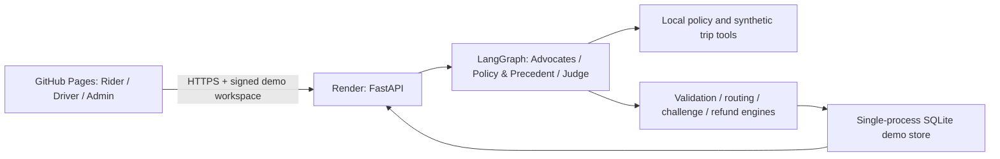

# RydeResolve Vision 5 — GitHub Pages + Render

A self-contained copy of the Vision 5 Python/LangGraph dispute app. GitHub Pages serves the frontend and Render runs the actual backend. The frontend does not substitute browser-only fake decisions.

- [Open the GitHub Pages demo](https://sprindy.github.io/ryderesolve-vision5-github-page/)
- [Deploy the backend on Render](https://render.com/deploy?repo=https://github.com/sprindy/ryderesolve-vision5-github-page)
- [Original app guide and demo scenarios](docs/VISION5_ORIGINAL_README.md)

## Architecture



## First deployment

The frontend is deployed by `.github/workflows/pages.yml` on pushes to `main`. Set Settings → Pages → Source to **GitHub Actions**.

1. Deploy the `render.yaml` blueprint, or create a Python web service using the commands below. Use the **free** plan and one worker.
2. Copy its HTTPS service URL, such as `https://your-service.onrender.com`.
3. Open the Pages site and enter that URL on **Connect your Render service**. The connection is checked against `/api/health` and saved in that browser.
4. For a shared default, set Settings → Secrets and variables → Actions → Variables → `BACKEND_URL` to the service origin, then rerun **Deploy GitHub Pages frontend**. This is a public URL, not a secret. Every visitor then gets their own signed demo workspace on the same backend.

### Render commands

Build: `pip install -r backend/requirements.txt`

Start: `python -m uvicorn app.main:app --app-dir backend --host 0.0.0.0 --port $PORT --workers 1`

Environment:

- `PYTHON_VERSION=3.11.11`
- `AGENT_MODE=deterministic`
- `CORS_ORIGINS=https://sprindy.github.io` (origin only, no repository path)
- `RYDE_DB_PATH=/tmp/ryderesolve/demo.sqlite`
- `DEMO_CONTROLS=1`
- `EVIDENCE_REQUIRED_TIMEOUT=finalize`

The Blueprint also includes local frontend origins and health checking. The API itself can serve Rider, Driver and Admin at `/rider`, `/driver`, `/admin`.

## Five-minute walkthrough

Use the same browser for all three roles.

1. Rider: submit `SIM-NS-005`.
2. Driver: show that only the affected Rider can challenge this preliminary decision.
3. Rider: download the demo server export, upload it, then submit the challenge.
4. Admin: inspect **Response rounds** and the revised ruling.
5. Rider: submit `SIM-LR-001` for the route/fare category.

Try `SIM-NS-004` for a Driver-side evidence challenge. Admin can simulate the 12-hour deadline.

## Local use

```bash
python3 -m venv .venv
source .venv/bin/activate
python -m pip install -r backend/requirements.txt
PORT=8001 bash start.sh
```

Open `http://127.0.0.1:8001/rider`, `/driver`, `/admin`. Local same-origin mode still works without Render or Pages.

## Real LLM mode

The complete LLM code is retained. The initial hosted service uses the same offline deterministic mode as the local demo and requires no model key. For real models, set `AGENT_MODE=llm`, `LLM_API_STYLE`, `LLM_BASE_URL`, `LLM_MODEL` and `LLM_API_KEY` in Render's server environment. Do not put model keys in GitHub Pages or public source. Review access and usage controls before enabling paid model calls on a public service.

## Scope and storage

All trip data is synthetic or an illustrative sample; payments, delivery notifications and exported trip evidence are simulated. Role switching is an explicit demo identity stub, not production authentication. A signed workspace isolates case records between visitors.

Render's free web service uses ephemeral storage: demo cases and workspace credentials may be lost after restarts, idle spin-down or redeployment. The frontend's existing identity-recovery flow creates a new isolated workspace when an old credential expires. Free services can need about a minute to wake up. This setup is suitable for a short hackathon presentation, not durable production case storage. See [Render free-service limits](https://render.com/docs/free).

The repo contains the complete app at its root (`backend`, `frontend`, `scripts`, `docs`, `archive`, startup scripts). It has no dependency on the other folders in the original repository. `SOURCE_COPY.json` records the source commit. Runtime databases, local credentials, virtual environments and `.env` are excluded.

No automated tests or live case rehearsals were run as part of this copying/deployment request. GitHub Pages packaging/deployment is not evidence of model quality or case correctness.
