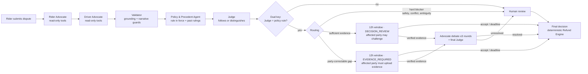

# RydeResolve: multi-agent dispute resolution for Ryde

**Three AI agents argue it, the affected party can challenge it, and code handles the money.**

Ride-hailing disputes (no-show fees, longer routes) take support teams 24–72 hours of manual review across GPS, chat, fare and policy records, and similar cases end with different rulings. RydeResolve resolves standard disputes in seconds. A Rider Advocate, a Driver Advocate and a Judge reason over read-only evidence tools. Deterministic engines own validation, confidence, deadlines and refunds. Humans review only the cases that are unsafe to automate.

Built for the **AI CAN DO IT · Tencent Cloud Hackathon Singapore 2026**, Digital Native track (Ryde): *Multi-Agent Autonomous Dispute Resolution System*.

## How a dispute flows



**Who may challenge?** Only the party adversely affected by the preliminary decision. A refund affects the Driver; an upheld charge affects the Rider.

**What if evidence is insufficient?** The agents still issue a preliminary decision from the verified records, but the window opens in `EVIDENCE_REQUIRED` mode:

- the affected party can challenge **only by uploading a document**; free text is not admitted;
- a document that matches the trusted trip source re-opens the case: both Advocates rebut with the new records and the final Judge rules;
- an unverifiable document goes to a human reviewer;
- no evidence by the deadline means the burden was not met, so the preliminary decision stands (`basis: BURDEN_NOT_MET`). Such outcomes are never used as precedents. Set `EVIDENCE_REQUIRED_TIMEOUT=human_review` to route these cases to a reviewer instead.

If no preliminary liability can be determined at all (for example, the platform's own navigation records are missing), there is no affected party, so the case goes to human review.

## The agents

| Agent | Does | Cannot |
|---|---|---|
| **Rider Advocate** | Chooses which read-only tools to call (trip, GPS, chat signals, fare breakdown, history, policy, precedents) and argues the rider's case with cited evidence IDs | Mutate data, calculate money, cite evidence it did not retrieve |
| **Driver Advocate** | Same, for the driver: arrival, waiting, contact attempts, route choice | Same |
| **Policy & Precedent Agent** | Runs before every Judge ruling: selects the policy version in force at the trip time, retrieves comparable past rulings (with the facts that differ), recommends an outcome and surfaces reviewer corrections awaiting approval | Decide liability; the Judge must follow its recommendation or name the facts that make the case different |
| **Judge** | Weighs both validated arguments, applies the pinned policy, returns liability, reason codes, a reviewer summary and plain-language explanations for each party | Calculate money; automate anything the policy rule disagrees with |

**Learning feedback.** When a reviewer overrides an automated outcome, it is saved as a correction awaiting policy-owner approval. Until approved, identical cases go to a person; once approved, it becomes a high-authority precedent. Five labelled synthetic past rulings ship with the demo so precedent retrieval is visible from the first case.

Everything else is deterministic code: validators, confidence engine, challenge gate, debate progress checker, policy-version selector, precedent consistency check, Refund Engine, deadlines.

## Guardrails (Responsible AI)

- **Grounding.** Every factual claim must cite evidence IDs the agent actually retrieved, and the cited records must entail the claim's value. Unsupported claims are rejected.
- **Dual-key automation.** The Judge's liability and reasons are compared with an independent deterministic policy rule. If they disagree, the case goes to human review with both views shown (`JUDGE_RULE_DISAGREEMENT`).
- **Narrative guards.** Agent prose may not contain money amounts or unknown evidence IDs.
- **Money is code.** The Refund Engine computes refunds in integer cents from verified pricing and machine-readable policy rules, with idempotency keys and a calculation trace.
- **History is context only.** Rider and driver history adjusts a 10% reliability factor and corroboration needs. It never decides liability.
- **Safety first.** Threats in chat or the complaint go straight to human review and block any timeout closure.
- **Prompt-injection hygiene.** Chat, complaints and uploads are treated as data, never as instructions. Tools are whitelisted, parameterised and scoped to the case.
- **Bounded autonomy.** At most 3 debate rounds, 12 tool turns per agent and one JSON repair turn. Any provider failure escalates to human review; there is no silent fallback to rules.

## Demo scenarios (synthetic data, official Ryde Help Center policy text)

| Trip | Situation | What happens |
|---|---|---|
| `SIM-NS-001` | Driver waited 4 min at the pin and messaged/called | Charge upheld → Rider may challenge (decision review) |
| `SIM-NS-003` | Driver cancelled after 2 min | Refund S$6.61 → Driver may challenge |
| `SIM-NS-004` | 2-min wait recorded only on the client clock | Preliminary refund, **Driver must supply evidence**. Upload the server export → agents debate → charge upheld. No upload → refund stands |
| `SIM-NS-005` | Rider moved the pickup pin; the change never reached the server | Preliminary charge upheld, **Rider must supply evidence**. Upload the pickup-change receipt → driver was at the old pin → refund S$6.61 |
| `SIM-LR-001` | Longer road, but the fastest GPS route with a fixed fare | Charge upheld; fare breakdown (surge, fee, promo) reconciles |
| `SIM-LR-002` | Platform navigation records missing | No liability possible → human review |
| `SIM-NS-002` | Arrival event and GPS disagree | Evidence-integrity conflict → human review |
| `SIM-SAFE-001` | Threat in chat | Safety → human review, no automation |
| `SIM-HIST-001` | Rider with a poor dispute history | History raises corroboration needs but does not change the outcome |

**Five-minute walkthrough:** In the Rider app, submit `SIM-NS-005`. Open the Driver app to see that the Driver cannot act. Back in the Rider app, click *Download demo server export*, upload it and submit the challenge. Then open Admin → *Response rounds* to watch the Rider Advocate and Driver Advocate debate and the Judge reverse the charge. Repeat with `SIM-NS-004` from the Driver side, and use Admin → *Simulate +12 hours* to see the burden-not-met path.

## Run it

Requires Python 3.11+.

```bash
python -m venv .venv
source .venv/bin/activate            # Windows: .\.venv\Scripts\Activate.ps1
pip install -r backend/requirements.txt
python -m uvicorn app.main:app --app-dir backend --host 127.0.0.1 --port 8000
```

Open http://127.0.0.1:8000/rider, `/driver` and `/admin`. The API docs are at `/docs`. Each browser gets an isolated, signed demo workspace in which you can switch between the three roles. This is an identity stub, not production login.

### Use a real model (Tencent Cloud or any OpenAI-compatible API)

Copy `backend/.env.example` to `backend/.env` and set:

```bash
AGENT_MODE=llm
LLM_API_STYLE=chat_completions
LLM_BASE_URL=https://api.hunyuan.cloud.tencent.com/v1     # or https://api.lkeap.cloud.tencent.com/v1 for DeepSeek
LLM_MODEL=hunyuan-turbos-latest                            # confirm the model name in your console
LLM_API_KEY=...
```

The key stays on the server. Without these settings the app runs fully offline with deterministic agents that follow the same contracts.

## Tests and benchmark

```bash
cd backend && python -m unittest discover -s tests -p "test_*.py"    # 109 tests, about 1 minute
cd .. && python scripts/demo_benchmark.py                               # 9 scenarios + evidence branches
python scripts/http_smoke.py                                            # real uvicorn server over HTTP
```

The suite covers the challenge-window rules, both evidence branches, idempotent settlement under concurrency, tampered uploads, prompt injection in complaints, policy-version pinning, precedent feedback, and the **LLM path end to end with a scripted model** (tool loop, JSON repair, dual-key disagreement, money-in-narrative rejection).

Latest deterministic benchmark ([docs/demo-benchmark-results.json](docs/demo-benchmark-results.json)): 9/9 scenarios pass. 4 go to decision review, 2 to evidence-required, 3 to human review. Median end-to-end assessment latency is about 0.3 s offline. These figures describe the synthetic fixture set only, not production accuracy.

## Repository layout

```
backend/app/
  main.py              FastAPI routes, signed demo identity, challenge/accept/upload endpoints
  workflow.py          compiled LangGraph: assessment, routing, debate loop, final Judge
  rider_agent.py  driver_agent.py  judge_agent.py  agent_shared.py   the three agents + LLM tool loop
  tools.py             whitelisted read-only evidence tools (trip, GPS, chat, chat signals, fare breakdown, history, policy, precedents)
  engines.py           facts, validators, liability rule, confidence, routing
  narrative.py         plain-language narratives + narrative guards
  settlement.py        challenge windows, human-review routing, idempotent Refund Engine
  evidence_intake.py   uploads, trusted-source verification, challenge gate
  knowledge.py         versioned policies, structured precedent retrieval, consistency check
  chat_analysis.py  history.py  provenance.py  simulation.py  store.py (SQLite)
frontend/              dependency-free HTML/CSS/JS: Rider, Driver and Admin views
scripts/               benchmark and HTTP smoke
archive/               notes and validation artefacts from earlier iterations
```

## Limitations (honest scope)

This is a hackathon demo. Data is synthetic or sample data, and policy effective dates are synthetic. Notifications and payments are mocked, and the 12-hour window runs on a virtual clock. Storage is single-process SQLite. Precedent retrieval is structured, not vector-based. The chat analyzer is a lexical demo, not a production classifier. Image evidence (damage/mess claims) is out of scope. Real-model quality has not yet been measured on a labelled set.
